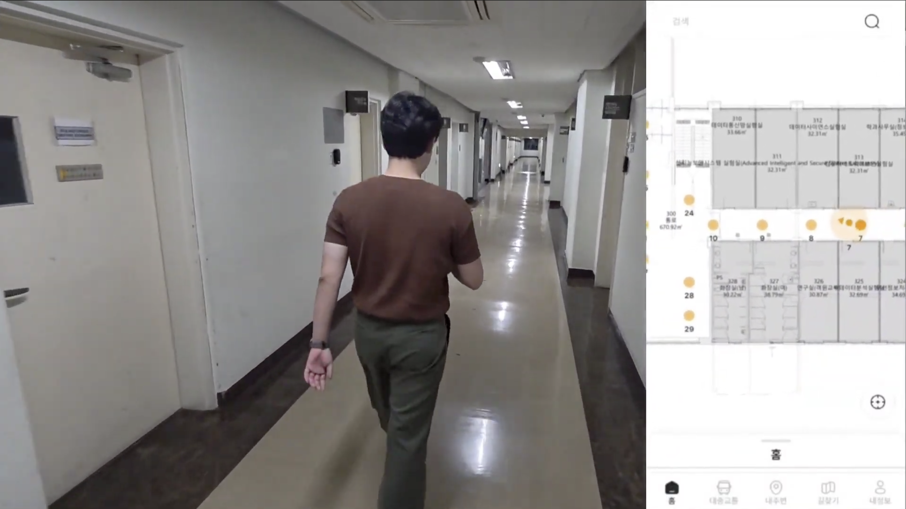
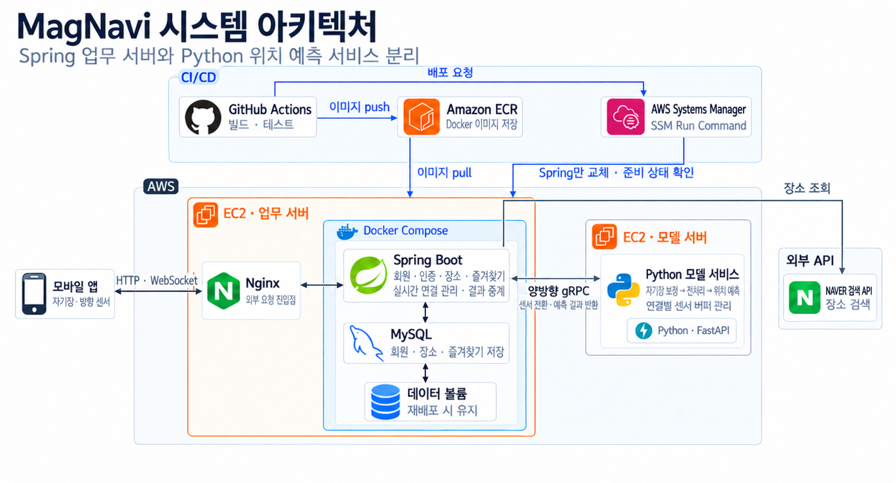
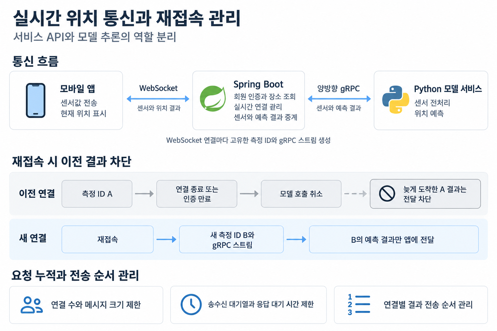
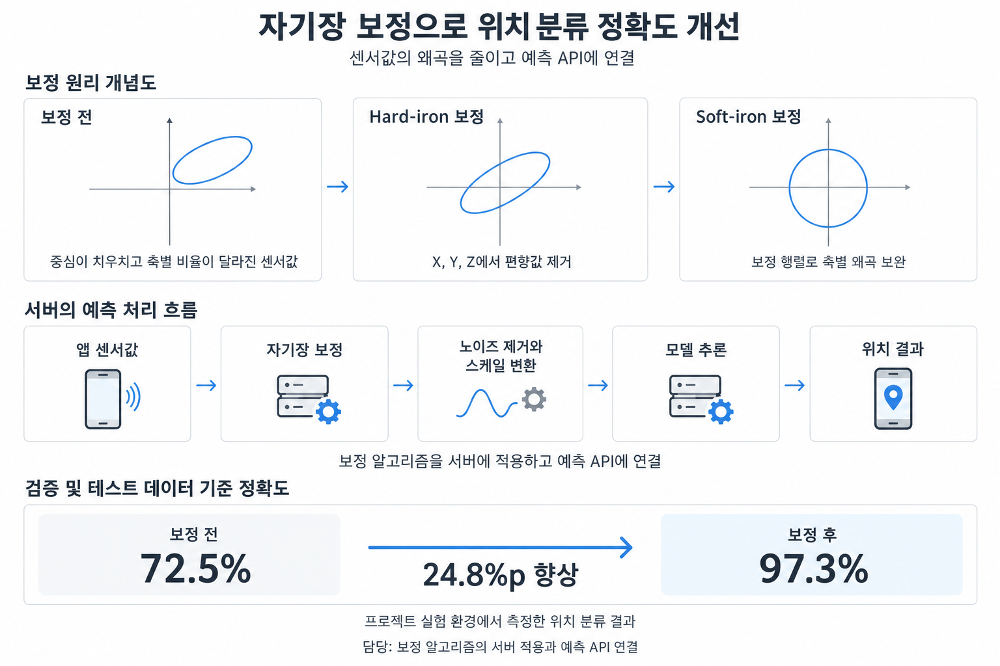
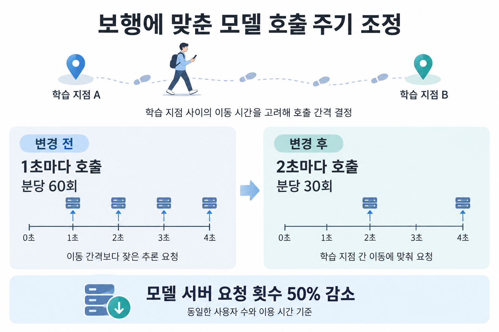

# MagNavi API Service

**회원·장소·즐겨찾기 API와 WebSocket–gRPC 중계를 담당하는 Spring 백엔드입니다.**

MagNavi는 GPS로 위치를 파악하기 어려운 실내에서 자기장·방향 센서와 딥러닝으로 위치를 구분하는 프로젝트입니다. 미리 측정한 공간의 자기장 패턴을 학습해 별도의 비콘 장비 없이 동작하는 프로토타입을 개발했습니다. 이 저장소는 **회원·인증·장소·즐겨찾기와 실시간 연결 관리**를 담당하고, Python 서버는 **센서 전처리와 위치 예측**을 담당합니다.

- **2025.02~2025.11:** 6명 팀 프로젝트 — 프론트엔드 3명·백엔드 3명, 팀장 및 서버·DB·AWS 인프라 담당.
- **2026.09~현재:** 백엔드 개인 고도화 — Spring 업무 API와 Python 모델 서비스의 역할 분리, 스트리밍 연동과 회귀 검증 진행.
- **이 저장소의 주요 구현:** JWT 인증과 본인 데이터 접근 제어, 모델 위치 코드의 장소 매핑, 측정별 실시간 연결·취소·재접속 관리, DB를 보존하는 Spring 자동 배포.
- **주요 결과:** 프로젝트 실험의 위치 분류 정확도 72.5% → 97.3%, 기존 HTTP 예측 요청 주기 1초 → 2초, WebSocket–gRPC 연결별 격리·취소·재접속 처리 구현.

[시연 영상](https://www.youtube.com/watch?v=kqR17mF1d1U) · [개발자 포트폴리오](https://app.notion.com/p/400dedc0d781803fb123c5aafc50e8b4) · [Python 저장소](https://github.com/MagNavi-server/magnavi-positioning-service) · [논문 정보](https://www.dbpia.co.kr/journal/articleDetail?nodeId=NODE12567180)

[](https://www.youtube.com/watch?v=kqR17mF1d1U)

*포트폴리오에 수록된 기존 앱 시연 화면입니다. 현재 Spring WebSocket v2로 전환한 앱의 시연 결과는 아닙니다.*

[아키텍처](#architecture) · [업무 기능](#features) · [실시간 통신](#realtime) · [자기장 보정](#calibration) · [호출 주기 개선](#interval) · [트러블슈팅](#troubleshooting) · [검증](#validation) · [실행·문서](#documents)

<a id="architecture"></a>
## 1. 시스템 아키텍처와 기술 선택



그림은 포트폴리오의 전체 구성도입니다. Spring의 업무 API·실시간 중계와 Python의 모델 계산을 분리했고, 두 서버 사이의 로컬 통신은 실제 모델로 검증했습니다. **그림에 표시된 앱 전환·운영 모델 연결·HTTPS/WSS까지 모두 검증한 상태는 아닙니다.** 확인한 배포 범위는 Spring 교체와 readiness 상태 확인이며, 상세 구분은 아래 검증 항목에 정리했습니다.

| 구성 | 역할과 선택 이유 |
|---|---|
| Java 21 · Spring Boot 4.1.1 | Spring Security와 JPA로 인증·데이터 접근·트랜잭션을 구성합니다. 업무별 패키지를 나누되 하나의 애플리케이션으로 빌드·배포합니다. |
| Spring Security · JWT · BCrypt | 로그인 후 액세스 토큰으로 사용자를 확인합니다. 비밀번호는 BCrypt 해시로 저장하고 본인 정보와 즐겨찾기 접근을 제한합니다. |
| JPA · MySQL · Flyway | 회원·장소·즐겨찾기의 관계를 외래 키와 고유 제약으로 관리합니다. SQL 변경 이력은 Flyway, 엔티티와 DB의 일치 여부는 JPA `validate`로 확인합니다. |
| WebSocket | 앱이 하나의 연결에서 센서를 계속 보내고 예측 결과를 받을 수 있게 합니다. STOMP 없이 JSON 메시지의 순서와 종료 규칙을 정의했습니다. |
| gRPC · Protobuf | Spring과 Python 사이에 양방향 스트림을 열고 센서·결과·오류의 형식을 계약으로 공유합니다. 채널은 재사용하고 측정마다 별도 스트림을 만듭니다. |
| Python · FastAPI | 기존 예측 API와 모델 실행 환경을 유지합니다. 새 스트리밍 통신은 별도 gRPC 진입점에서 처리하며 전처리·추론은 Python에서 수행합니다. |
| Docker · GitHub Actions · AWS | 컨테이너로 실행 환경을 고정합니다. PR에서는 빌드·테스트를 수행하고, `release` 반영 시 검증한 이미지를 ECR에 올려 SSM으로 EC2의 Spring을 교체합니다. |

Spring은 `member`, `place`, `favorite`, `positioning` 모듈로 나눴습니다. 각 모듈 안에서 요청 해석, 업무 처리, 도메인 규칙, JPA·JWT·gRPC 연결을 구분합니다. 다른 모듈의 저장소를 직접 호출하기보다 공개 조회 기능과 필요한 ID로 협력하며, 측정 스트림 전체를 DB 트랜잭션으로 묶지 않습니다.

```text
src/main/java/com/example/magnavi_springserver/
├── member/        # 회원가입·로그인·JWT·본인 정보
├── place/         # 건물·층·실내 장소·모델 코드 매핑·외부 검색
├── favorite/      # 본인의 실내 장소 즐겨찾기
├── positioning/   # WebSocket 연결·gRPC 중계·순서·취소·한도
├── shared/        # 공통 오류·요청 추적·값 검증
└── config/        # 보안·모델·WebSocket 설정 조립
```

[모듈 구조](docs/modules/README.md) · [DB 스키마](DATABASE_SCHEMA.md) · [빌드 설정](build.gradle)

### 배포 과정에서 DB를 유지하고 Spring만 교체

- `develop`·`release` 대상 PR에서 Java 빌드, 격리 MySQL 테스트, 배포 실패 경로와 Compose 구문을 검사합니다.
- 중앙 `release`에 반영되면 해당 커밋을 다시 검증한 뒤 OIDC로 임시 AWS 권한을 받습니다. 장기 AWS 액세스 키를 배포 작업에 저장하지 않습니다.
- 이미지를 ECR에 올린 뒤 내용으로 식별하는 digest를 배포에 사용합니다. 같은 태그가 다른 이미지로 바뀌어도 배포 대상을 혼동하지 않도록 했습니다.
- SSM으로 EC2에서 기존 MySQL과 볼륨을 확인하고 Spring 컨테이너만 교체합니다. readiness와 원격 명령의 성공·종료 코드를 확인한 뒤 성공 버전을 기록합니다.
- GitHub 실행 순서와 EC2 잠금으로 동시 배포를 제어하며, 복구에 필요한 이전 이미지·Compose 정보를 남깁니다. 자동 복구와 별개로 수동 복구 절차를 문서화했습니다.

[CI·배포 흐름과 복구 절차](docs/CI_CD.md) · [구현 PR #26](https://github.com/MagNavi-server/magnavi-api-service/pull/26)

<a id="features"></a>
## 2. Spring으로 옮긴 업무 기능

기존 Python 서버가 서비스 API와 모델 추론을 함께 담당하던 구조에서, 먼저 Spring의 DB·인증 기반을 만들고 장소 조회·즐겨찾기·실시간 중계를 순서대로 연결했습니다. 새 스키마와 기능을 검증한 상태이며, 기존 운영 데이터 이관과 모바일 앱 전환은 별도로 진행해야 합니다.

### 회원·인증: 요청의 회원 번호 대신 검증된 토큰 사용

- 일반 회원가입·로그인, 내 정보 조회, 내 이름 변경 API를 구현했습니다. 가입은 JSON, 로그인은 기존 형태를 고려한 폼 요청으로 받습니다.
- BCrypt로 비밀번호를 저장하고 로그인 성공 시 30분 액세스 JWT를 발급합니다. 서명·발급자·대상·만료를 검사한 뒤 토큰의 내부 회원 번호로 본인을 찾습니다.
- 이름 변경 요청에 다른 회원의 ID나 권한이 들어와도 변경 대상으로 사용하지 않습니다. 가입 시 동시 중복 요청은 DB 고유 제약과 오류 변환으로 처리합니다.
- 기존 Python의 해시 형식과 맞는 합성 자료로 BCrypt 호환성을 확인했습니다. 이는 기존 회원 데이터를 실제로 이관했다는 의미는 아닙니다.

[회원 API와 검증 범위](docs/api/MEMBER_API.md) · [구현 PR #12](https://github.com/MagNavi-server/magnavi-api-service/pull/12)

### 장소·검색: 모델 코드와 서비스의 장소 ID 분리

- 건물 → 층 → 실내 장소의 계층 조회와 활성 장소 필터를 구현했습니다. 목록은 `skip`·`limit` 범위를 검사하고 최대 100개로 제한합니다.
- 모델의 위치 코드가 곧 DB의 장소 ID라고 가정하지 않았습니다. **모델 키·버전·위치 코드** 조합으로 장소를 조회하므로 모델 버전마다 다른 코드 체계를 연결할 수 있습니다.
- `007`과 `7`을 구분하고 대소문자·공백도 임의로 바꾸지 않습니다. 매핑이 없거나 장소가 비활성이면 `NOT_FOUND`와 `location=null`을 반환합니다.
- 장소 목록은 필요한 정보를 함께 읽도록 구성했습니다. 합성 장소 105개를 추가한 테스트에서도 전체 목록 SQL 1회, 층별 목록 SQL 2회를 확인했습니다.
- 네이버 지역 검색은 별도 API로 연결했습니다. 검색어·정렬·응답 크기·호출 시간과 동시 호출 수를 제한하고 외부 오류를 공통 오류 형식으로 변환합니다. 검색 결과를 자동으로 DB에 저장하지 않습니다.

[장소 API](docs/api/PLACE_API.md) · [모델 위치 매핑](docs/api/MODEL_LOCATION_MAPPING.md) · [외부 검색 API](docs/api/PLACE_SEARCH_API.md)

### 즐겨찾기: 소유권·중복·목록 조회를 함께 처리

- 실내 장소의 즐겨찾기 등록·내 목록 조회·삭제를 구현했습니다. 회원 번호는 JWT에서 가져오고 즐겨찾기 ID는 서버가 발급합니다.
- 등록 시 대상 장소를 확인하고, 같은 회원의 중복 등록과 동시 요청은 DB 고유 제약으로 제어합니다. 삭제할 때도 즐겨찾기 ID와 소유 회원을 함께 검사합니다.
- 한 페이지의 장소 ID를 모아 최대 100개 장소를 묶어서 읽습니다. 즐겨찾기마다 별도 SQL을 반복하지 않으며, 장소가 비활성화된 항목은 목록에서 사용 불가 상태로 구분합니다.
- 테스트에서는 타인 접근, 동시 등록·삭제, 외래 키·고유 제약 위반과 트랜잭션 롤백을 확인했습니다.

[즐겨찾기 API](docs/api/FAVORITE_API.md) · [구현 PR #18](https://github.com/MagNavi-server/magnavi-api-service/pull/18)

<a id="realtime"></a>
## 3. WebSocket·gRPC 실시간 통신과 재접속 관리



위치를 계속 갱신하려면 통신 연결을 유지해야 합니다. 그런데 같은 회원이라는 이유로 이전 연결의 결과를 새 연결에 보내면, 재접속 직후 과거 위치가 현재 위치를 덮어쓸 수 있습니다. 이를 막기 위해 **회원과 측정을 구분하고, 한 WebSocket 연결을 하나의 측정으로 관리**했습니다.

### 연결부터 결과 전달까지

1. **인증:** `/ws/positioning`의 HTTP 업그레이드 요청에서 Bearer JWT를 확인합니다. URL 쿼리로는 토큰을 받지 않으며 연결 중에도 만료를 검사합니다.
2. **측정 시작:** 앱의 `start`에서 계약 버전·모델·센서 프로필을 검사합니다. 새로운 측정 ID와 gRPC 스트림을 만들고, 모델의 `ready`를 앱에 전달한 뒤 센서를 받습니다.
3. **센서 전달:** `sequence`는 1부터 하나씩 증가하고 `elapsedNanos`는 첫 입력 0 이후 증가해야 합니다. 누락·중복·역순과 잘못된 숫자를 거절하고 해당 측정의 스트림으로만 전달합니다.
4. **결과 전달:** Python의 예측에서 최상위 위치 코드를 장소 정보에 연결합니다. 연결별 작업자가 DB 조회와 앱 송신을 순서대로 처리하므로 gRPC 수신 콜백에서 DB 응답을 기다리지 않습니다.
5. **종료·재접속:** `stop`, 소켓 종료, 인증 만료, 시간 초과 시 gRPC 호출을 취소합니다. 종료 후 도착한 결과는 폐기하고 재접속은 새 ID·새 스트림으로 시작합니다.

### 느린 연결 때문에 요청이 계속 쌓이지 않도록 제한

- 전체·회원별 연결 수, 입력 메시지 크기·빈도, gRPC 입력·결과 대기열에 한도를 둡니다.
- 시작·유휴·모델 응답·앱 송신의 대기 시간을 나눠 제한합니다. 초과 시 오류를 전달하고 해당 연결을 정리합니다.
- DB 조회가 늦게 끝나더라도 결과를 새 연결에 전달하지 않습니다. 작업자가 실제로 종료될 때까지 연결 슬롯을 유지해 정리 중인 작업자가 계속 늘지 않도록 합니다.
- 센서 원본과 상세 예측 이력은 업무 DB에 저장하지 않습니다.

| WebSocket 설정 | 현재 기본값 |
|---|---|
| 인스턴스 전체 / 회원별 동시 연결 | 32개 / 2개 |
| 입력 메시지 크기 / 초당 메시지 수 | 4,096바이트 / 연결당 100개 |
| 시작 / 유휴 / 송신 대기 | 10초 / 30초 / 3초 |
| 기능 활성화 | 기본 비활성 |

위 값은 개발 단계의 제한값이며 실측한 처리량 보장 수치는 아닙니다. 실제 모바일의 센서 단위·축·전송 주기와 운영 부하를 확인한 뒤 조정해야 합니다.

[WebSocket 계약·오류·설정](docs/api/POSITIONING_WEBSOCKET.md) · [gRPC 계약·대기열·취소](docs/api/MODEL_GRPC.md) · [구현 PR #29](https://github.com/MagNavi-server/magnavi-api-service/pull/29)

<a id="calibration"></a>
## 4. 자기장 보정으로 위치 분류 정확도 개선



초기 프로젝트에서 위치 분류 정확도가 정체되어 센서값과 전처리 과정을 점검했습니다. 관련 논문을 검토하며 스마트폰의 자성 부품과 센서 특성에 따른 편향·축별 왜곡이 입력에 영향을 줄 수 있음을 확인했고, 이를 보완하는 보정 알고리즘을 예측 API에 적용했습니다.

- **Hard-iron 보정:** 자기장 X·Y·Z에서 각 축의 편향값을 빼 측정값의 치우침을 보정합니다.
- **Soft-iron 보정:** 편향을 제거한 3축 벡터에 보정 행렬을 곱해 축별 크기와 축 사이의 왜곡을 보완합니다.
- **예측 흐름 연결:** 보정 → 센서 윈도우 갱신 → 웨이브렛 잡음 완화 → 스케일링 → MLP 추론 순서를 Python에 구현했습니다. Spring은 이 계산을 중복하지 않고 센서와 결과를 중계합니다.

```text
보정 자기장 = 보정 행렬 × (측정 자기장 − 편향)
```

포트폴리오와 기존 프로젝트 기록의 검증·테스트 데이터 기준 위치 분류 정확도는 **72.5% → 97.3%, 24.8%p 향상**입니다. 관련 논문은 영남대학교 IT관 3층 복도의 29개 지점을 대상으로 한 실험을 다룹니다. 이 수치는 당시 실험 환경의 결과이며, 현재 서버 연동 테스트에서 정확도를 다시 측정한 값은 아닙니다. API의 `score` 역시 개별 모델 점수로, 이 정확도와 구분합니다.

[기존 평가 기록](https://github.com/MagNavi-server/magnavi-positioning-service/blob/c41e0a86d6c2b407f91b1230a191eee487096a15/README.md) · [보정·전처리 코드](https://github.com/MagNavi-server/magnavi-positioning-service/blob/c41e0a86d6c2b407f91b1230a191eee487096a15/services/model_service.py) · [논문 정보](https://www.dbpia.co.kr/journal/articleDetail?nodeId=NODE12567180)

<a id="interval"></a>
## 5. 보행 특성을 고려한 모델 호출 횟수 50% 감소



기존 앱은 모델 서버를 1초마다 호출했습니다. 사용자가 다음 학습 지점에 도착하기 전에 추론이 반복되는 점을 확인하고, 지점 사이를 걷는 데 필요한 시간을 기준으로 호출 간격을 검토했습니다. 당시 보행 조건에서는 2초 간격이 적절하다고 판단해 HTTP 예측 요청 주기를 조정했습니다.

- **변경 전:** 사용자당 분당 60회 호출.
- **변경 후:** 사용자당 분당 30회 호출.
- **결과:** 같은 사용자 수와 이용 시간 기준 호출 횟수 50% 감소. 요청마다 수행하는 추론 횟수도 함께 줄었습니다.

이는 **기존 앱의 HTTP 호출 주기를 바꾼 개선 기록**입니다. 현재 Spring 스트리밍 서버에 2초마다 입력을 버리는 로직을 추가한 것은 아닙니다. 새 구조에서는 센서를 순서대로 전달하고 Python이 최근 16개 윈도우를 관리하므로, 앱 전환 시 전송 주기와 학습 조건을 다시 맞춰야 합니다. 호출 감소율을 CPU 사용량·응답시간·비용의 50% 감소로 환산하지는 않았습니다.

[기존 앱 호출과 전환 조건](docs/api/POSITIONING_WEBSOCKET.md#5-확인한-모바일-앱과-남은-작업)

<a id="troubleshooting"></a>
## 6. 서버를 연결하며 해결한 문제

### 첫 샘플부터 예측하는 Python과 초기 대기를 요구한 Spring

Python은 초기 입력이 16개보다 적으면 마지막 값으로 채우는 `pad` 방식으로 첫 샘플부터 예측했습니다. 기존 Spring은 1~15번째 입력에 `warming_up`을 요구해 정상 예측을 계약 오류로 거절할 수 있었습니다. 연동 준비 중 코드와 전처리 설정을 대조해 이 차이를 확인했습니다.

- 모델 계산을 바꾸지 않고 gRPC·WebSocket 동작 계약을 **v2**로 맞췄습니다. `requiredCount=16`은 필터 윈도우 크기이며 응답을 시작하는 입력 개수가 아닙니다.
- 첫 샘플부터 `prediction`을 받도록 수정하고 기존 v1 요청은 거절합니다. 앱도 시작 버전과 초기 응답 처리를 함께 전환해야 합니다.
- 실제 Java → Python 호출에서 합성 입력 144개의 위치 코드·후보·점수가 기존 결과와 일치하는지 확인했습니다. 첫 번째·15번째·16번째 입력도 비교에 포함했습니다.

[해결 PR #31](https://github.com/MagNavi-server/magnavi-api-service/pull/31) · [상세 원인과 검증](https://github.com/MagNavi-server/magnavi-positioning-service/blob/c41e0a86d6c2b407f91b1230a191eee487096a15/docs/troubleshooting/grpc-first-prediction.md)

### WebSocket 테스트 정리 중 간헐적인 `Output closed`

잘못된 요청의 오류 응답과 모델 취소까지 확인한 테스트가 연결 정리 단계에서 간헐적으로 실패했습니다. 종료 상태 확인과 직접 종료 요청 사이에 JDK의 자동 종료 응답이 처리될 수 있어, 상태를 확인했을 때와 실제 전송할 때의 연결 상태가 달라졌습니다.

- Java 21의 종료 처리 순서를 확인하고 테스트용 소켓으로 같은 오류를 재현했습니다. 최초 실패 당시의 스레드 실행 순서를 직접 수집한 것은 아닙니다.
- 종료 알림 기록과 상태 확인·종료 요청을 같은 잠금으로 보호했습니다. 완료 대기는 잠금 밖에 두어 종료 콜백을 막지 않도록 했습니다.
- 통신 오류와 시간 초과는 숨기지 않고 전달하며, 실패한 연결은 강제로 정리합니다.
- 추가 회귀 테스트 7개 중 기존 코드에서 5개가 실패했고, 수정 후 7개와 기존 실제 WebSocket 통합 테스트 12개가 통과했습니다. 변경 범위는 테스트 보조 코드와 회귀 검사입니다.

[해결 PR #33](https://github.com/MagNavi-server/magnavi-api-service/pull/33) · [종료 경합 회귀 테스트](src/test/java/com/example/magnavi_springserver/positioning/PositioningWebSocketProbeTests.java)

<a id="validation"></a>
## 7. 검증과 배포 범위

각 기능을 따로 확인한 뒤, 자동 테스트 클라이언트 → Spring 인증·WebSocket 중계 → 실제 Python 모델 → 장소 매핑 → 같은 WebSocket 응답까지 연결했습니다. DB는 Testcontainers의 격리 MySQL을 사용하고 모델 비교에는 고정된 합성 입력과 기존 기준 결과를 사용했습니다.

| 확인한 범위 | 기록된 결과와 근거 |
|---|---|
| 업무 API·DB | JWT 위조·만료·타인 접근, 목록 범위, DB 제약·롤백, 검색의 외부 장애·한도 검증. 각 API 문서에 상세 기록 |
| 실시간 실패 경로 | 연결 격리·재접속·취소·느린 송신·늦은 결과 차단. 특정 경합 순서는 제어 가능한 대역 테스트로 재현 |
| 실제 Python 종단 | 2026-10-31 전체 **280개 테스트·빌드 통과**, 실패·오류·건너뜀 0. 새 WebSocket 테스트의 기준 예측 비교 **528회**, 직접 gRPC 경로 **144개** 비교. [PR #35](https://github.com/MagNavi-server/magnavi-api-service/pull/35) |
| GitHub CI | PR #35의 빌드·격리 MySQL·배포 스크립트·Compose 검사 성공. Python 환경 미지정으로 실제 모델 테스트 5개는 건너뜀. [CI 실행](https://github.com/MagNavi-server/magnavi-api-service/actions/runs/41787016599) |
| 첫 Spring 자동 배포 | 2026-10-13 기록: OIDC → ECR → SSM → Spring 교체·readiness 확인 성공. MySQL 컨테이너·볼륨 보존. [배포 실행](https://github.com/MagNavi-server/magnavi-api-service/actions/runs/38285003424) |

테스트 개수와 배포 결과는 **해당 날짜의 검증 기록**입니다. 이번 README 작성 과정에서 기능 테스트나 운영 배포를 새로 실행하지 않았습니다. 특히 첫 자동 배포는 이후 추가한 WebSocket v2와 실제 Python 종단 기능의 운영 검증을 뜻하지 않습니다.

**남은 작업**

- 모바일 앱의 WebSocket v2 전환과 실제 센서 단위·축·주파수 확인, 운영 장소·모델 매핑 데이터 준비.
- Linux에서의 실제 모델 연결, HTTPS/WSS·운영 모델 통신, 동시 사용자 부하·지연·자원 사용 측정.
- 카카오·구글 로그인, 토큰 재발급·로그아웃, 교통·외부 장소 즐겨찾기, 기존 데이터 이관.
- 실제 네이버 API 키를 사용한 호출·좌표·앱 지도 표시 검증.

<a id="documents"></a>
## 8. 실행과 상세 문서

JDK 21과 Docker가 필요합니다. 로컬 DB·환경변수·JWT 키·Spring 실행 순서는 [개발 실행 안내](docs/DEVELOPMENT_GUIDE.md)를 따릅니다. 기본 테스트는 별도 MySQL 컨테이너를 생성하므로 개발 DB를 먼저 실행할 필요는 없습니다.

```bash
# Docker가 실행 중인 환경에서 수행합니다.
./gradlew test
./gradlew build
```

실제 Python 검증은 [모델 검증 환경 준비](docs/api/MODEL_GRPC.md#10-websocket부터-실제-python까지-통합-검증2026-10-31)를 마친 뒤 `MAGNAVI_PYTHON_ROOT`에 Python 저장소 경로를 지정합니다. 이 변수가 없으면 실제 모델 테스트 5개는 건너뜁니다. HTTP readiness는 앱·DB 상태이며 모델 준비 완료를 뜻하지 않습니다.

| 문서 | 내용 |
|---|---|
| [개발 실행 안내](docs/DEVELOPMENT_GUIDE.md) | MySQL·환경변수·Spring 실행·오류 응답·단계별 검증 기록 |
| [회원](docs/api/MEMBER_API.md) · [장소](docs/api/PLACE_API.md) · [검색](docs/api/PLACE_SEARCH_API.md) · [즐겨찾기](docs/api/FAVORITE_API.md) | HTTP 요청·응답·오류·전환 조건 |
| [WebSocket](docs/api/POSITIONING_WEBSOCKET.md) · [gRPC](docs/api/MODEL_GRPC.md) · [모델 매핑](docs/api/MODEL_LOCATION_MAPPING.md) | 실시간 계약·한도·취소·모델 코드의 장소 연결 |
| [모듈](docs/modules/README.md) · [DB 스키마](DATABASE_SCHEMA.md) | 책임 분리·테이블·제약 |
| [Docker·EC2](docs/DEPLOYMENT.md) · [CI/CD](docs/CI_CD.md) | 배포 설정·실행 순서·실패 시 복구 절차 |
| [프로젝트 개요](PROJECT_OVERVIEW.md) · [구현 계획](IMPLEMENTATION_PLAN.md) | 설계 배경과 단계별 계획. 최신 연동 검증은 위 PR·API 문서 참고 |

정리 기준: **2026-11-05**, 중앙 `develop`의 PR #35·#36 반영 상태. Python README와 프로젝트 소개·목차·포트폴리오 이미지를 공유하고, 이 문서에서는 Spring의 구현 과정을 더 자세히 설명합니다. 본문의 이미지 5개는 제공된 포트폴리오에서 가져왔으며 [이미지 출처](docs/images/portfolio/README.md)에 정리했습니다.
